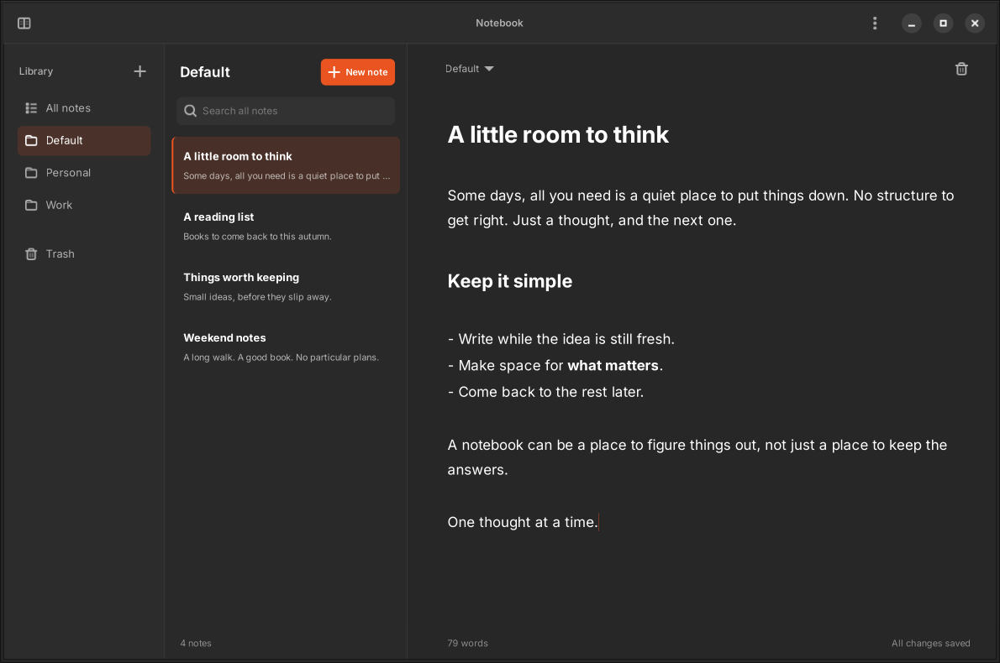

# Notebook

A native Linux note-taking app built with Rust and GTK4. Organize your notes into notebooks, write with a minimal rich text editor, and keep everything on your computer. No account or internet connection required.

An [Android app](#android) shares the same Rust core and syncs with it.



## Features

- **Rich text editing** that keeps formatting visible while you type. Type `/` for a searchable block menu with Text, headings H1–H6, bulleted and numbered lists, to-do lists, and quotes. Use selection shortcuts or the context menu for bold, italic, and strikethrough.
- **Notebooks and search** to organize notes and find them by word or word prefix.
- **Automatic saving** as you write, with your last note and cursor position restored when you reopen the app.
- **Focus mode** to hide navigation and give your writing more room.
- **Trash and restore** for recovering deleted notes.
- **Sync between your devices**, peer to peer. Pair devices with a code; edits made on several devices at once merge instead of overwriting each other.
- **Native appearance** that follows your GTK theme, including light and dark modes.

## Install

On Ubuntu 24.04 or newer, or Debian 13, on amd64, install Notebook or update it to the latest release with:

```sh
curl -fsSL https://raw.githubusercontent.com/pkkulhari/notebook/master/install.sh | sh
```

The script downloads the latest release's Debian package, checks it against its SHA-256 checksum, and installs it with apt, which asks for your password.

## Build and run

To build Notebook, you'll need Rust 1.92 or newer, a C compiler, `pkg-config`, and GTK 4.12 or newer.

On Ubuntu 24.04, install the system dependencies:

```sh
sudo apt install build-essential pkg-config libgtk-4-dev
```

With Rust installed, run these commands from the repository directory:

```sh
cargo build --release
./target/release/notebook
```

SQLite is bundled. Notebook supports Wayland and X11.

### Debian / Ubuntu package

With the build dependencies above installed, generate a release package:

```sh
cargo install cargo-deb --locked
cargo deb -p notebook --locked
```

The `.deb` is written to `target/debian/` and includes a desktop application launcher. Install it with:

```sh
sudo apt install ./target/debian/notebook_0.6.1-1_amd64.deb
```

The filename depends on the package version and build architecture. Runtime dependencies are determined from the build system, so build on the oldest Debian or Ubuntu release you intend to support (with GTK 4.12 or newer).

## Using Notebook

Choose **New Note** or press **Ctrl+N** to start writing. New notes begin in **Default**. The first nonempty line becomes the note's title in the list, so there's no separate title field.

Create a notebook with the sidebar's **+** button. Use its **⋮** menu to rename or delete it. To move a note, select the notebook label above the editor. Deleting a notebook moves its notes into **Default**.

Search finds notes across all notebooks. While viewing **Trash**, search finds deleted notes instead. Restore a trashed note to edit it again.

Notes are still stored as Markdown for compatibility and sync, but supported formatting markers stay hidden even when you select or edit text. Copying copies the visible text. Type `/` at the start of a line or after a space to open the block menu, then type to filter (for example, `/h2`, `/todo`, or `/quote`). Use ↑/↓ to navigate and Enter or Tab to apply; Escape closes the menu and keeps your typed text. Choosing a command converts the current line and removes the command text. Slashes in URLs, paths, and code do not open the menu.

Selecting text opens the same formatting menu, with bold, italic, strikethrough, headings H1–H6, lists, and quotes. Inline styles apply to the selected text; block styles apply to every selected line. Click a choice or use ↑/↓ and Enter to apply it. Escape or clicking outside closes the menu without applying formatting. Formatting is also available through shortcuts and the right-click menu. List shortcuts work on the current line or selected lines; Enter continues a list, and Enter on an empty item ends it. Pasting a web or email address makes it a link, and pasting one over selected text links that text; pastes into code stay plain. Type `/link`, choose **Link** from the selection menu, or press **Ctrl+K** to type a URL for a new link or for the selected text. **Ctrl+click** opens web and email links. Tables, images, and HTML remain source text.

To-do items (`- [ ]` and `- [x]`) display as working checkboxes. Click a checkbox, or focus it and press Space, to mark a task complete or incomplete. Changes save and sync with the note and can be undone with **Ctrl+Z**.

### Syncing your devices

Sync is off until you turn it on. Open the sync button in the header bar, or **Sync devices** in the menu, and turn on **Sync with your other devices** on each device.

To pair two devices, choose **Show a pairing code** on one and enter that code on the other. Both devices must be on the same local network while pairing, and each code expires after five minutes or three wrong attempts. Paired devices find each other on the local network and sync whenever they can reach each other, including changes made while they were apart. Notes open in the editor update as the other device types, and **Undo** only undoes your own edits. **Remove** stops syncing with a device.

Notes travel directly between your devices over encrypted connections, and only paired devices can connect. Without a relay, nothing leaves your local network. To sync devices on different networks, run a relay server such as [`iroh-relay`](https://docs.iroh.computer/concepts/relays) and enter its address under **Sync over the internet** on every device. The relay only passes along encrypted traffic.

Devices find each other with mDNS and sync over UDP, so a firewall must allow both on the local network.

### Keyboard shortcuts

| Action | Shortcut |
| --- | --- |
| New note in Default | Ctrl+N |
| Search all notes | Ctrl+F |
| Toggle focus mode | F9 |
| Save immediately | Ctrl+S |
| Undo / redo | Ctrl+Z / Ctrl+Shift+Z |
| Open block menu / filter commands | Type `/` |
| Navigate / apply / close block menu | ↑↓ / Enter or Tab / Escape |
| Bold / italic (selected text) | Ctrl+B / Ctrl+I |
| Strikethrough (selected text) | Ctrl+Shift+X |
| Link (selected text or at caret) | Ctrl+K |
| Bulleted / numbered list | Ctrl+Shift+7 / Ctrl+Shift+8 |
| Trash / restore note | Ctrl+Shift+Delete |
| Return focus to editor | Escape |

## Your data

Notes are stored locally in a SQLite database at:

```text
~/.local/share/notebook/notebook.db
```

If `XDG_DATA_HOME` is set to an absolute path, the location is `$XDG_DATA_HOME/notebook/notebook.db` instead. To back up your notes, close Notebook and copy its data directory. The database keeps each note's edit history so that devices can merge their changes.

Sync settings, this device's private key, and the list of paired devices are kept separately, in `~/.config/notebook/sync.json` (or under `$XDG_CONFIG_HOME`). Copying your notes to another computer therefore doesn't copy its sync identity: pair the new computer, and its copy of the notes merges without duplicating them.

Notebook saves after a short pause in typing and at least every two seconds while you keep writing. If saving fails, it keeps your draft in memory and offers a retry. Undo history lasts for the current session.

This version does not include import/export, attachments, or permanent deletion of trashed notes.

## Android

The Android app in `android/` uses the same Rust core for storage, Markdown, and sync, with a small Kotlin interface on top. It needs Android 16 or newer.

### Build and install

You'll need the Android SDK with NDK `29.0.14206865`, the Rust targets `aarch64-linux-android` and `x86_64-linux-android`, and [`cargo-ndk`](https://github.com/bbqsrc/cargo-ndk):

```sh
rustup target add aarch64-linux-android x86_64-linux-android
cargo install cargo-ndk --locked
cd android
./gradlew installDebug
```

Gradle builds the Rust library and its Kotlin bindings itself; no separate `cargo` step is needed. Debug builds include arm64 and x86_64 (for the emulator). `./gradlew assembleRelease` builds an optimized, arm64-only APK. To sign it, add `android/keystore.properties` with `storeFile`, `storePassword`, `keyAlias`, and `keyPassword`; git ignores it. `-PreleaseAbis=x86_64` builds a release for the emulator instead.

`./gradlew connectedDebugAndroidTest` runs the instrumented tests against a throwaway database. Gradle uninstalls the app afterwards, notes included, so run them on an emulator or a phone whose notes you don't need.

### On the phone

The phone app includes the same rendered Markdown editing, slash commands, selection formatting, and interactive task checkboxes as the desktop. Type `/` to search for a block type, or select text and use the floating toolbar for bold, italic, strikethrough, headings H1–H6, lists, and quotes. Tap a checkbox to toggle it; formatting and checkbox changes save, sync, and undo separately from typing. Pasting a web or email address makes it a link, or links the selected text. Type `/link`, choose **Link** in the toolbar, or press **Ctrl+K** to type a URL. Hardware keyboards support the formatting shortcuts above. Copying gives the visible text, and pasted formatting is discarded.

Notebooks, search, list continuation, trash, and undo of only your own edits also work on the phone. Tap the title to switch notebooks, and the notebook label above a note to move it.

Notes are stored in the app's private storage (`notebook.db`) and are included in Android backups. The sync key lives in a directory Android never backs up, so a phone restored from a backup must be paired again; its notes merge with your other devices' copies without duplicating.

Sync runs only while the app is open. Pair a phone with the desktop app or another phone the same way as on the desktop, on the same Wi-Fi network. Android 17 asks for permission to find devices on the local network when you turn sync on; without it, sync works only through a relay.
